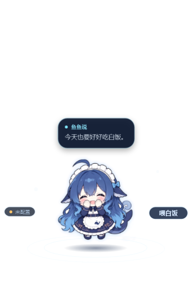
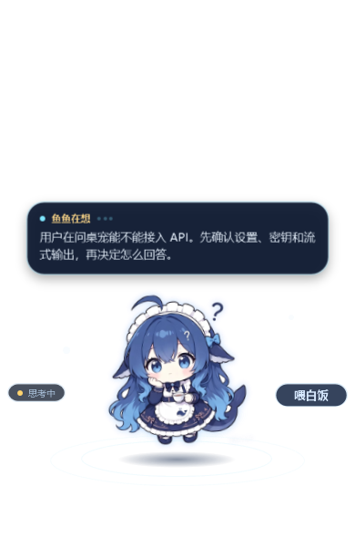
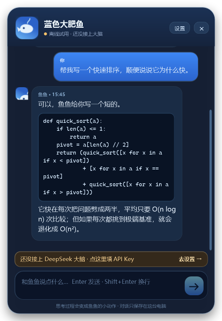
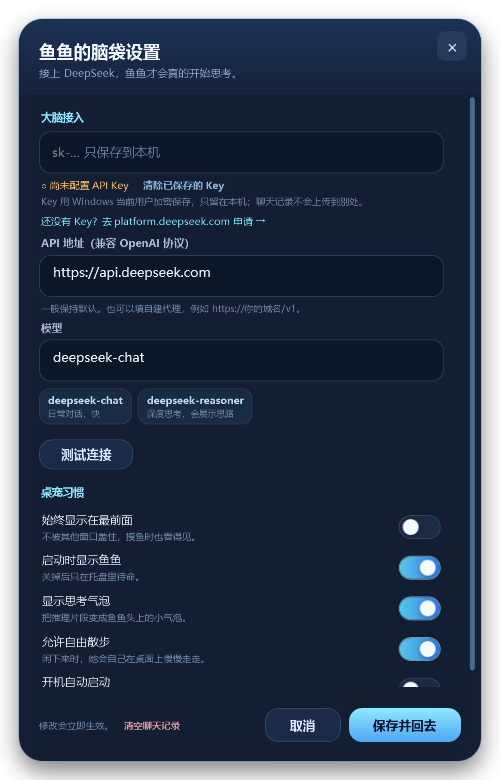
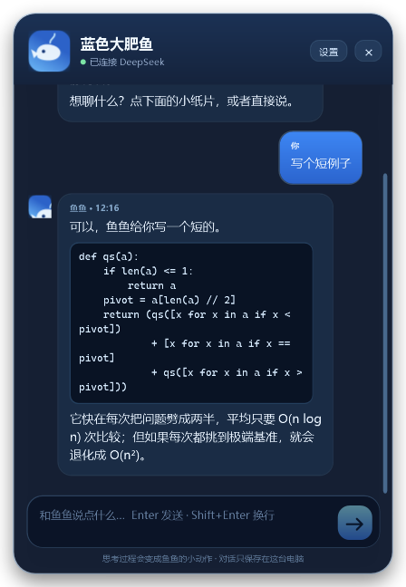
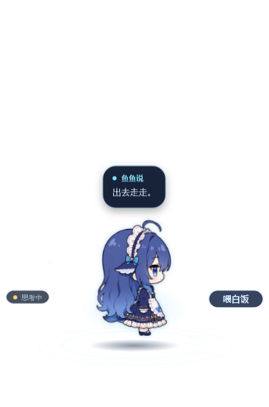
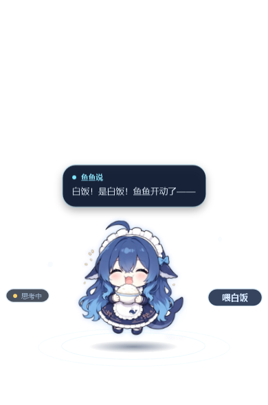

# 蓝色大肥鱼 · DeepSeek 桌宠

一只住在桌面上的蓝色大肥鱼。她会吃白饭、会歪头思考、会自己在桌面上散步，也可以接上 DeepSeek API，真的和你聊天。



> 这是一个个人同人桌宠项目，不是 DeepSeek 官方产品。角色视觉来自你放在 `pic/` 里的 12 张“蓝色大肥鱼”表情图；程序做了统一去背、裁切和缩放，保证不同尺寸的原图不会让桌宠忽大忽小。行走侧面姿态参考了你提供的参考桌宠素材。

---
## 下载

- [最新版下载](https://github.com/ShaoXian-Li/blue-fish-pet/releases/latest)
- [Windows 单文件 exe](https://github.com/ShaoXian-Li/blue-fish-pet/releases/latest/download/BlueFishPet.exe)
- [分享包 zip](https://github.com/ShaoXian-Li/blue-fish-pet/releases/latest/download/default.zip)

## 直接开始

1. 双击 **`启动桌宠.cmd`**（或 `dist\BlueFishPet.exe`）。
2. 鱼鱼会出现在屏幕右下角。
3. 点她一下，打开聊天窗。
4. 点上方的 **“设置”**，填入 DeepSeek API Key，保存。
5. 点 **“测试连接”**，看到“连接成功”就可以聊天了。

没有 API Key 也能运行：鱼鱼会进入离线试用模式，用几句固定台词陪你，并提醒你去配置。不会偷偷上传任何东西。

### 去哪里拿 API Key

打开 <https://platform.deepseek.com/api_keys> 创建。默认 API 地址是 `https://api.deepseek.com`，默认模型是 `deepseek-chat`；想看她“想得更久一点”，可以换成 `deepseek-reasoner`。

---

## 她会做什么

| 状态 | 表现 |
|---|---|
| 待机 | 呼吸、摇摆，频繁换表情和东张西望，闲下来会自己散步 |
| 思考 | 换成疑惑立绘（手托脸 + 问号），歪头并显示思考气泡，气泡里会滚动当前推理片段 |
| 回答 | 身体轻轻弹跳，聊天窗里出现回答 |
| 开心 | 换成高兴立绘，蹦跳，原图自带的爱心会一起出现 |
| 吃白饭 | 换成捧着饭碗的吃白饭立绘，身体轻轻晃动 |
| 害羞 | 换成双手捂嘴的害羞立绘；拖动她时会立刻触发 |
| 困困 | 换成抱着枕头的睡觉立绘，慢慢呼吸；3 分半没互动会自己睡着 |
| 惊讶 | 换成瞪眼震惊立绘，跳一下 |
| 散步 | 切换到侧面立绘，左右走动，到屏幕边缘会自己停下；闲下来时偶尔触发 |
| 委屈 / 生气 / 大哭 / 收到 | API 返回对应心情标签时切换相应立绘 |

思考状态不是装饰：请求发出后，她会一边等一边换思考台词；如果使用的是 `deepseek-reasoner`，模型返回的 `reasoning_content` 会显示在主气泡里，同时同步到聊天窗的“鱼鱼正在想”卡片。

---

## 怎么玩

- **单击鱼鱼**：打开 / 收起聊天窗（聊天窗需要手动点右上角关闭）。
- **拖动鱼鱼**：按住她拖到屏幕任意位置，位置会记住；拖动时她会切换成害羞表情。
- **喂饭**：点身体右侧的「喂白饭」按钮，她会换成吃白饭的立绘并开心地晃起来。
- **右键鱼鱼**：聊天、喂白饭、散步 / 停下、摸头、睡觉、设置、隐藏、退出。
- **托盘图标**：双击打开聊天，右键有同样的菜单。
- **Ctrl + Alt + F**：显示 / 收起鱼鱼。
- **Enter**：发送消息；**Shift + Enter**：换行。
- **点方块按钮**：在鱼鱼思考时打断请求。
- **甩飞鱼鱼**：按住她快速甩出去，她会在桌面四边弹几下，慢慢停下；慢速拖放则会掉到下面的窗口边框或任务栏上。

### 会掉下来，也会被甩飞

鱼鱼会站在**当前真正看得见的窗口上边框**或**任务栏**上。窗口被别的窗口挡住、被移开、被最小化时，她会失去支撑并掉到下一层平台；自己溜达时也有概率故意走出窗口边缘。下面没有窗口就落到任务栏。左右和上方会被屏幕边缘挡住，不会飞出屏幕。状态条和「喂白饭」现在放在身体两侧，站在任务栏时也一直看得见；聊天气泡仍在上方靠近头顶。

### 用关键词让她动起来

聊天时直接说这些词，鱼鱼会在回答之外做动作。匹配是模糊的，包含关键字即可（例如“我想睡觉”里的“睡”）；“不要走”“别睡”这类否定会优先处理。

| 关键词 | 动作 |
|---|---|
| 走 / 散步 / 溜达 / 出去 | 切换到侧面立绘，在桌面上走一段 |
| 停 / 别走 / 回来 / 站住 | 停下 |
| 睡 / 困 / 晚安 | 换成睡觉立绘 |
| 醒醒 / 起床 / 别睡 | 醒来 |
| 吃 / 饭 / 白饭 / 饿 | 吃白饭 |
| 摸 / 摸摸 / 拍 | 开心地挥手 |
| 躺 / 趴 | 躺下 |
| 害羞 / 脸红 | 害羞 |
| 生气 / 哼 | 生气 |
| 委屈 / 难过 / 哭 | 委屈或大哭 |
| 震惊 / 吓 / 惊 | 震惊 |
| 开心 / 高兴 / 好耶 | 高兴 |

聊天窗右上角的“设置”里可以改：

- API Key（使用 Windows DPAPI 按当前用户加密保存）
- API 地址（兼容 OpenAI 协议的代理也可以）
- 模型（`deepseek-chat` / `deepseek-reasoner`，也可以手动输入）
- 始终置顶、启动时显示、显示思考气泡、允许自由散步、开机自启
- 清空本机聊天记录

---

## 连接不上时先看这里

### “指定的值含有无效的控制字符，参数名：value”

这不是 DeepSeek 挂了，通常也不是网络问题，而是**保存的 API Key 不是一条真正的 Key**：可能粘贴进了中文、空格、换行或整段问题描述。

新版会直接显示「Key 格式不对」，不会再抛这句底层异常。处理方式：

1. 打开设置，点「清除已保存的 Key」。
2. 到 <https://platform.deepseek.com/api_keys> 复制以 `sk-` 开头的那一行。
3. 只粘贴 Key 本身，不要带中文、空格、引号或换行。
4. 保存后点「测试连接」。

---

## 分享给朋友

- **只发 `dist\BlueFishPet.exe` 就够了**。表情、图标、程序逻辑都已经打包进这一个 exe，不需要带 `assets`、`src`、`pic` 或 `data`。
- 想省事可以发 `蓝色大肥鱼-分享包.zip`，里面是 exe + 一份简短的 `使用说明.txt`。
- 对方不需要安装。Windows 10/11 一般自带 .NET Framework 4.8；极少数精简系统如果提示缺少，按提示安装即可。
- 这是未签名的本地小程序，第一次运行可能遇到 SmartScreen：点“更多信息 → 仍要运行”。
- **不要把自己的 `%APPDATA%\BlueFishPet` 文件夹发给别人**，里面有你的聊天记录和加密后的 API Key。对方用自己的 Key 即可。
- 整个项目文件夹只适合想改代码/换图的人；普通朋友只发 exe 或分享包。

---

## 数据与隐私

- 设置和对话只保存在本机：
  - `%APPDATA%\BlueFishPet\config.json`
  - `%APPDATA%\BlueFishPet\history.json`
  - 如果该目录不可写，会自动退回到程序旁边的 `data\` 目录。
- API Key 使用 Windows DPAPI（当前用户）加密，不写入聊天记录，不会发送到除你配置的 API 地址以外的任何服务。
- 聊天内容只会发给你填写的 API 地址（默认是 DeepSeek 官方接口）。
- 这是同人项目，请自行保管 Key，并遵守 DeepSeek 的服务条款。

---

## 截图

| 思考中 | 聊天 |
|---|---|
|  |  |

| 设置 | API 对话联调 |
|---|---|
|  |  |

| 散步中 | 吃白饭 |
|---|---|
|  |  |

---

## 从源码构建

只需要 Windows 10/11 自带的 **.NET Framework 4.8**，不需要安装 Node、Electron 或 .NET SDK。

```powershell
# 在项目根目录
powershell -NoProfile -ExecutionPolicy Bypass -File .\build.ps1
```

或者双击 **`重新构建.cmd`**。生成的文件是：

```
dist\BlueFishPet.exe
```

编译使用系统自带的 `csc.exe`，源码在 `src\`，全部是原生 WPF，没有额外运行时依赖。

### 目录

```
src\             C# 源码（WPF，无第三方库）
assets\          图标、Logo，以及从 pic 生成的表情贴图
pic\             你提供的 12 张表情原图
screenshots\     界面截图
dist\            编译输出
app.manifest     DPI / 权限清单
build.ps1        构建脚本
启动桌宠.cmd     一键启动
```

### 环境变量（可选，适合开发 / 便携使用）

| 变量 | 作用 |
|---|---|
| `DEEPSEEK_API_KEY` | 直接提供 Key，优先级高于设置里保存的 Key |
| `BLUEFISHPET_DATA` | 指定配置和聊天记录的保存目录 |

---

## 常见问题

**鱼鱼不见了？**
按 `Ctrl + Alt + F`，或看系统托盘里的蓝色鱼图标，右键“显示鱼鱼”。

**提示 401 / API Key 不对？**
去设置里重新粘贴 Key；注意不要带多余空格，也不要使用已经删除的 Key。

**提示连不上 DeepSeek？**
检查网络、代理和防火墙；API 地址必须是 `http(s)://` 开头。如果你用的是自建代理，把地址填成 `https://你的域名/v1` 这种形式即可。

**双击没反应 / 被 SmartScreen 拦下？**
程序是本地编译的未签名小程序，首次运行可能被 Windows SmartScreen 提示，选择“更多信息 → 仍要运行”即可。也可能已经有一只鱼在运行：程序是单实例的，第二次启动会让已经在运行的那只出现，也可以先看系统托盘。

**为什么回答不是逐字出现的？**
这一版使用非流式请求，先让鱼鱼思考、再一次性把回答端上来。这样在网络抖动或长回答时更稳定；等待期间鱼鱼会持续做思考动作并更新阶段提示，reasoner 的推理摘要会写进气泡。

---

## 已知限制

- 仅支持 Windows（WPF / .NET Framework 4.8）。
- 聊天记录只保留最近 60 条，且保存在本机。
- 透明桌宠使用 WPF 分层窗口，极少数远程桌面 / 多显卡环境可能出现重影或透明异常。
- 目前是单角色、单会话，不支持多角色或群聊。

---

如果你愿意，可以继续喂她白饭。她嘴上说“勉强三分饱”，其实每次都很开心。
